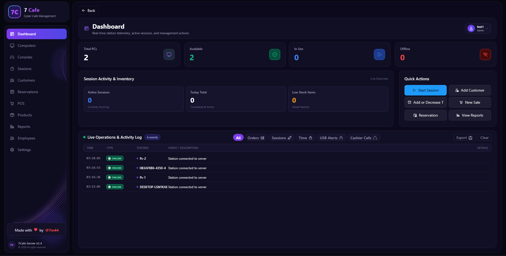
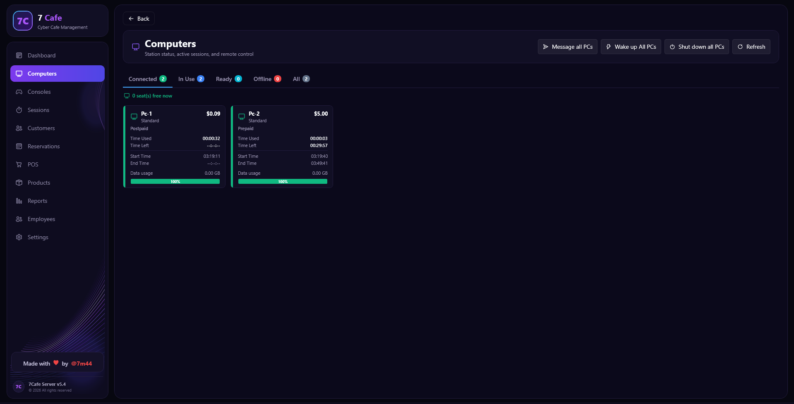
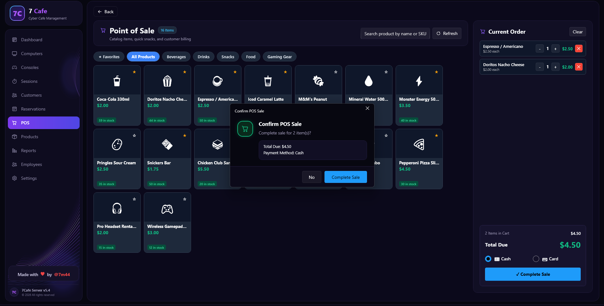
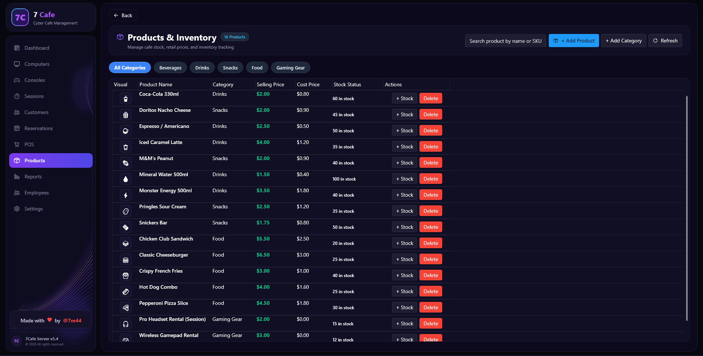
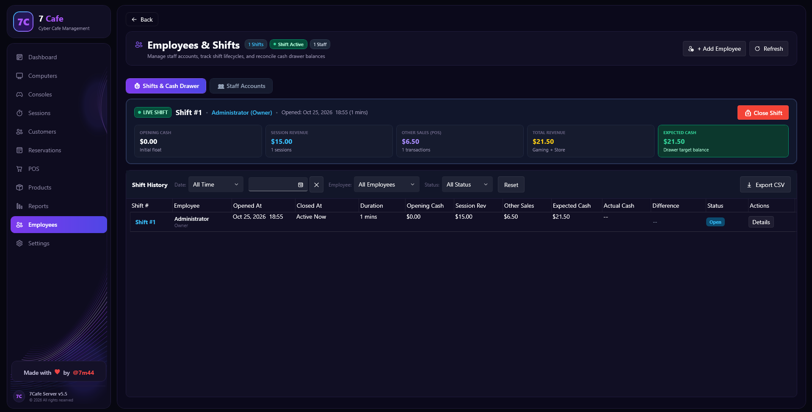
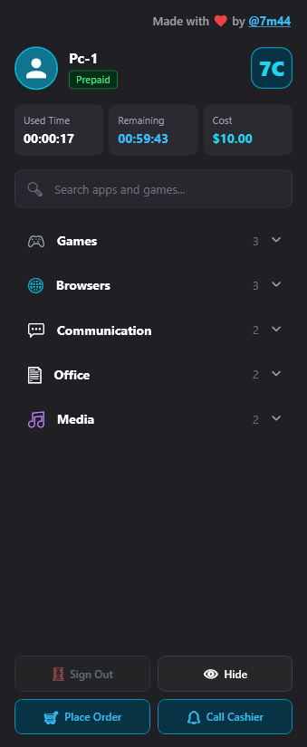

  

  # 7Cafe — Cyber Cafe & Gaming Lounge Management

  **Your Easiest, Cheapest, and Most Premium Way to Manage Your Cyber Cafe & Gaming Lounge.**

  
  
  [-8B5CF6?style=for-the-badge)](#pricing-plans)
  
  

   

  

---

## 📌 Table of Contents
- [What is 7Cafe?](#-what-is-7cafe)
- [Key Highlights](#-key-highlights)
- [Why 7Cafe vs Legacy Systems?](#-why-7cafe-vs-legacy-systems)
- [Feature Walkthrough](#-feature-walkthrough)
  - [1. Real-Time Dashboard & Station Control](#1-real-time-dashboard--station-control)
  - [2. Built-in POS & Checkout](#2-built-in-pos--checkout)
  - [3. Inventory & Stock Management](#3-inventory--stock-management)
  - [4. Financial & Cash Drawer Shift Tracking](#4-financial--cash-drawer-shift-tracking)
  - [5. PlayStation & Console Module](#5-playstation--console-module)
  - [6. Client Floating In-Seat Experience](#6-client-floating-in-seat-experience)
- [Pricing Plans](#-pricing-plans)
- [7-Day Free Trial](#-7-day-free-trial)
- [Support & Contact](#-support--contact)

---

## 💡 What is 7Cafe?

**7Cafe** is a modern, high-performance management software designed specifically for cyber cafes, esports arenas, and gaming lounges. 

Tired of legacy, bloated, and ad-ridden software that requires painful static IP setups and crashes during peak hours? **7Cafe** solves that with a sleek dark-themed interface, zero-configuration network discovery, automated shift accounting, integrated retail POS, and PlayStation/Console timer management.

---

## ✨ Key Highlights

- 🔌 **Zero IP Hassle & Plug-and-Play**: Automatic local network discovery. Stations connect to the server instantly without configuring static IPs or modifying router ports.
- 🚫 **100% Ad-Free**: Absolutely zero popups, zero third-party banners, and zero tracking. Your bandwidth stays clean and your clients enjoy distraction-free gaming.
- ⚡ **Unlimited Stations (No PC Limit)**: Connect 10, 50, or 100+ PCs and gaming consoles on a single flat license without tier limits or per-seat fees.
- 🎮 **PC + Console Hybrid**: Unified billing for PC workstations and PlayStation / Xbox / Nintendo consoles in one place.
- 🛡️ **Zero Cash Discrepancies**: Automated shift opening float, session revenue vs. retail POS sales segregation, and drawer reconciliation.

---

## ⚔️ Why 7Cafe vs Legacy Systems?

| Feature | Legacy Systems (HandyCafe, CyberCafePro, etc.) | 7Cafe Modern Platform |
| :--- | :--- | :--- |
| **Ads & Popups** | ❌ Full of ads, banners, and slow trackers | ✅ **100% Ad-Free & Clean** |
| **Network Setup** | ❌ Complex static IPs & router port-forwarding | ✅ **Zero-Config Automatic Discovery** |
| **PC Limits** | ❌ Expensive tiered pricing per station | ✅ **Unlimited Stations (No PC Limit)** |
| **Interface** | ❌ Dated 2000s Windows XP look | ✅ **Ultra-modern Dark Cyberpunk UI** |
| **Integrated POS** | ❌ Limited or requires external apps | ✅ **Fast Built-in POS with Barcode Search** |
| **Console Support**| ❌ Weak or non-existent | ✅ **Native PlayStation / Console Module** |
| **Pricing** | ❌ Expensive renewals & hidden costs | ✅ **Starting at $4/mo or $30 Lifetime** |

---

## 🖥️ Feature Walkthrough

### 1. Real-Time Dashboard & Station Control
Monitor every client PC and console session with live timers, current spend, and one-click actions (Lock, Unlock, Add Time, Transfer Session, Restart, Shutdown, Send Message).

  

---

### 2. Built-in POS & Checkout
Accelerate cafeteria, snack, and drink sales with instant barcode/item search, customizable fast-picks, and the ability to charge orders directly to the active PC session or settle as cash walk-in.

  

---

### 3. Inventory & Stock Management
Keep track of your lounge's inventory with categorized products, cost vs. retail pricing, instant quantity adjustments, and automated low-stock warnings.

  

---

### 4. Financial & Cash Drawer Shift Tracking
Eliminate cash discrepancies with shift tracking. Monitor opening float, break down session revenue vs. retail POS sales in real time, and verify drawer balances before ending shifts.

  

---

### 5. PlayStation & Console Module
Manage console gaming sessions alongside your PCs. Start single or multiplayer matches, pause timers, add snacks to the check, and print a consolidated receipt when players finish.

---

### 6. Client Floating In-Seat Experience
Delight your gamers with a sleek, non-intrusive floating client bar that displays remaining time, total spent, cashier call button, and in-seat cafeteria ordering without disturbing active games.

  

---

## 💰 Pricing Plans

Transparent pricing with zero hidden fees and continuous developer updates:

| Plan | Price | Billing | Features |
| :--- | :---: | :--- | :--- |
| **Monthly Plan** | **$4** | Billed Monthly | Unlimited Stations, 100% Ad-Free, Developer Support |
| **Lifetime Plan** ⭐ *(Best Value)* | **$30** | **One-Time Payment** | **Permanent License (Zero Renewals)**, Unlimited Stations, 100% Ad-Free, Priority Developer Support |
| **Yearly Plan** | **$15** | Billed Annually | Unlimited Stations, 100% Ad-Free, Developer Support |

> [!TIP]
> All plans include **Unlimited Stations (No PC Limit)** — you never pay extra when you add more PCs or consoles to your venue.

---

## 🎁 7-Day Free Trial

Experience 7Cafe on your venue floor before paying a single cent:
1. Message us on Telegram: **[@blank12x](https://t.me/blank12x)**
2. Request your instant **7-Day Full-Featured Trial License**.
3. Install the server and client in minutes — no credit card required.

---

## 📞 Support & Contact

Have questions, need assistance, or want to activate your license?
- **Telegram Direct**: [@blank12x](https://t.me/blank12x)
- **Developer**: @7m44
- **Project Website**: [7Cafe Landing Page](https://github.com/)

---

  
Crafted with ❤️ for cyber cafe & gaming lounge owners worldwide.

  
<strong>7Cafe &copy; 2026. All rights reserved.</strong>

